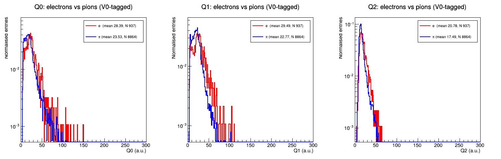
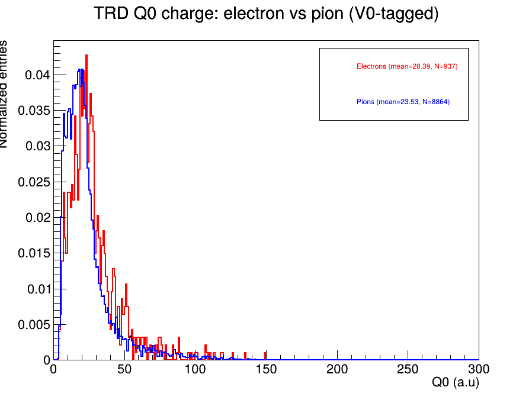

# ALICE TRD Analysis: Electron-Pion Separation in Run 3 PbPb

Analysis code for an MSc thesis on electron identification with the ALICE Transition Radiation Detector (TRD) in Run 3 PbPb collisions at 5.36 TeV.

**Author:** Madhva Fakare, MSc Physics, University of Münster
**Supervisors:** Dr. Guido Willems (day-to-day), Prof. Anton Andronic (PI), AG Andronic, Institut für Kernphysik

---

## Physics motivation

Electrons from heavy-flavour decays are a key probe of the quark-gluon plasma, but in PbPb collisions they are swamped by a pion background several orders of magnitude larger. The TRD separates the two by exploiting transition radiation: ultra-relativistic electrons crossing the radiator emit X-rays that add to the ionisation signal, while pions at the same momentum do not.

Each TRD chamber digitises the signal into three charge windows per tracklet, Q0, Q1 and Q2, covering different drift-time intervals. Q1 contains the transition-radiation peak and carries the most separation power. The ALICE design goal is a pion efficiency below 1% at 90% electron efficiency when all six layers are combined.

This project reproduces the classical likelihood approach on Run 3 data and compares it against a gradient-boosted-tree classifier trained on the same samples.

---

## Approach

The analysis proceeds in two stages, each with its own detector.

**Stage 1, TPC.** Establish a clean reference using specific energy loss. This stage covers Bethe-Bloch parametrisation in βγ space, photon-conversion tagging via V0 topology (Armenteros-Podolanski selection, conversion radius, ψ-pair), and quantification of the residual pion contamination in the resulting electron sample. The TPC group has already published this measurement; reproducing it serves as validation of the selection chain.

**Stage 2, TRD.** Apply the same topologically tagged samples to the TRD charge signal. Build per-layer reference distributions for electrons and pions, combine the layers into a likelihood (LQ1D, with LQ3D as a later extension once statistics allow), and measure the pion-rejection factor as a function of momentum. The same samples then train an XGBoost classifier exported to ONNX, giving a like-for-like comparison between the classical and ML approaches on identical input.

---

## Data

Run 3 PbPb 2023, `apass5`, periods LHC23zzf through LHC23zzo.

Two input formats are used:

- **TPC skim** (`O2tpcskimv0wde`, `O2tpctofskimwde`), produced by `DPG/Tasks/TPC/tpcSkimsTableCreator`. Carries V0 topology variables and the mother-hypothesis PID label.
- **TRD skim** (`SkimmedTRDV0Tree`, `SkimmedTRDTOFTree`), produced by `trdSkimsTableCreator`. Carries per-layer corrected charges Q0, Q1, Q2 for all six layers, a good-layer mask, and the V0 topology variables.

Species tagging is topological throughout: gamma conversions give electrons, K0S and Lambda decays give pions. The tag comes from the reconstructed V0 mother hypothesis, not from a dE/dx cut, so the TPC response remains an independent observable.

---

## Selected figures

**Armenteros-Podolanski plane, LHC23zzf.** V0 candidates separate into three disjoint regions: the low-qT photon band, the K0S arc, and the Lambda and anti-Lambda horns. The photon band is the electron source for this analysis; selecting it topologically is what makes the TPC and TRD responses independent observables.


**TRD charge slices, electrons versus pions.** The three charge windows carry different separation power. Q1, which covers the transition-radiation peak, separates best, and Q0, the amplification peak, worst. The ordering matches the slice-to-time-bin assignment documented in the literature.



**Integrated TRD charge per layer.** Electrons show a systematically higher mean charge and a heavier high-charge tail, visible on a logarithmic scale. The distributions overlap substantially in a single layer, which is why the layers must be combined before a usable rejection factor is reached.



---

## Repository layout

```
my-analysis/
├── tpc/
│   ├── macros/            Bethe-Bloch fits, dE/dx, nSigma, V0 gamma tagging, purification
│   └── plots/
├── trd/
│   ├── macros/            Q-slice comparisons, separation power, likelihood, tree inspection
│   │   ├── README.md      Index: which macro reads histograms, which reads the flat tree
│   │   └── archive/       Numbered practice iterations; higher number = later version
│   ├── plots/             All TRD figures. Macros write here by absolute path.
│   └── all_q.txt          Captured console output of trd_all_q.C
├── trdskims/
│   └── configuration.json Workflow configuration for the TRD skim task
├── tasks/
│   └── myFirstTask.cxx    Minimal O2Physics task
└── macros/archive/        Earlier exploratory macros, kept for reference
```

See `trd/macros/README.md` for the full TRD macro index. Selected macros:

| Macro | Purpose |
|---|---|
| `tpc/macros/learn_gammatag.C` | V0 gamma tagging and Armenteros-Podolanski selection |
| `tpc/macros/purify_electrons.C` | Production run of the purified electron sample |
| `trd/macros/explore_tree.C` | Per-track inspection of the TRD charge tree |
| `trd/macros/trd_q_slices.C` | Q0/Q1/Q2 separation power, electrons vs pions |
| `trd/macros/trd_likelihood.C` | Likelihood construction from per-layer reference distributions |
| `trd/macros/count_trdpid.C` | Sample yields after quality cuts |

---

## Running the analysis

### Environment

The TRD skim task is not part of upstream O2Physics, so a local build is required. CVMFS dailies cannot run it.

```bash
alienv enter O2Physics/trd-pidstudy-local2
```

The environment name carries a revision suffix that changes whenever the build hash changes. Check with `alienv q | grep -i o2physics` if the name above is not found.

### Rebuilding after editing a task

A full `aliBuild` pass rebuilds all 3167 O2Physics targets and takes hours. For a single-file change, build the one target directly:

```bash
cd ~/alice/sw/BUILD/O2Physics-latest/O2Physics
ninja o2-analysis-trd-skims-table-creator
```

This takes a couple of minutes. The resulting binary lands in `stage/bin/` rather than on the environment PATH:

```bash
export PATH=~/alice/sw/BUILD/O2Physics-latest/O2Physics/stage/bin:$PATH
```

### Producing the TRD skim

```bash
o2-analysis-trd-skims-table-creator \
    --aod-file <AO2D.root> \
    --configuration json://trdskims/configuration.json \
    --aod-writer-json writer.json \
    --usePionsFromLambda --rejectDuplicateDaughters \
    -b
```

`writer.json` needs OutputDirector entries naming `AOD/TRDSKIMV0/0` and `AOD/TRDSKIMTOF/0`, otherwise the tables are produced but never written to disk.

### Running macros

```bash
root -l -q trd/macros/trd_q_slices.C
```

---

## Analysis notes

Findings that cost time to establish, recorded so they need not be rediscovered.

**`fPidIndex` is a topological label, not a measurement.** It is inherited from the reconstructed V0 mother hypothesis via `createV0Mother()` in `tpcSkimsTableCreator.cxx` and written out as an `o2::track::PID::ID` value (electron 0, pion 2, proton 4). It never encodes a per-track dE/dx result.

**The PCM ellipse is redundant once `fPidIndex == 0` is required.** On LHC23zzf, 429,047 of 429,048 `fPidIndex == 0` tracks survive the Armenteros ellipse. The ellipse therefore cannot serve as an independent purity handle; ψ-pair and conversion radius are the candidate independent cuts.

**The charge slices are not in time order.** Per Table 4.1 of Felix Schlepper's thesis, Q0 covers time bins 1-6 (amplification peak), Q2 covers bins 7-13 (plateau), and Q1 covers bins 14-20 (transition-radiation peak). The 6-bit versus 7-bit hardware ranges explain the asymmetric quality cuts (62 for Q2, 127 for Q0 and Q1) rather than any physics choice.

**Histogram entries in the original PID task are per tracklet, not per track.** The charge histograms are filled inside a loop over six layers, so with a four-tracklet minimum the entry count overstates the track count by roughly a factor four. Per-track analysis requires the flat tree.

**Species enum collision.** The TRD skim labels pions as 1, following the internal `Daughter` enum of the TPC skim task. In the ALICE standard `o2::track::PID::ID`, 1 is a muon. The two must not be joined without translation.

**Missing-value conventions.** In the TRD skim, layers failing the charge cuts are stored as -999, and with `zeroIsMissing` enabled a window whose raw charge is exactly zero is also stored as -999 even in an otherwise good layer. Every charge cut needs an explicit validity check; a bare branch name used as a ROOT cut means "not equal to zero", which -999 satisfies.

---

## Credits

The TRD skim task `trdSkimsTableCreator` was written by Kangkan Goswami (IIT Indore), building on `DPG/Tasks/TPC/tpcSkimsTableCreator` from O2Physics. The geometric charge correction and the `TRDsExtra` table are likewise his work.

The likelihood method and its LQ1D/LQ3D variants follow Felix Schlepper's master thesis, *Electron identification with the ALICE TRD in LHC Run 3 and 4*, which is the closest prior work to this analysis.

The contribution of this repository is the validation and debugging of that chain on Run 3 PbPb data, the resolution of the open questions recorded under Analysis notes, and the comparison of the classical likelihood against an XGBoost classifier on identically tagged samples.

---

## References

- ALICE Collaboration, *Particle Identification with the ALICE Transition Radiation Detector*, [arXiv:1402.3508](https://arxiv.org/abs/1402.3508)
- ALICE Collaboration, *The ALICE Transition Radiation Detector: construction, operation, and performance*, NIM A 881 (2018) 88, [arXiv:1709.02743](https://arxiv.org/abs/1709.02743)
- F. Schlepper, *Electron identification with the ALICE TRD in LHC Run 3 and 4*, MSc thesis

---

## Environment

C++17, ROOT 6.36, O2Physics (local development build), AlmaLinux 9.
